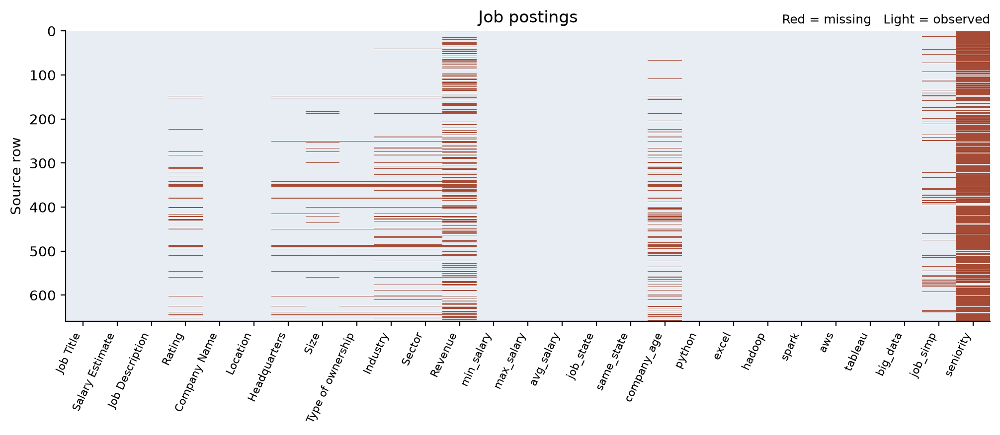
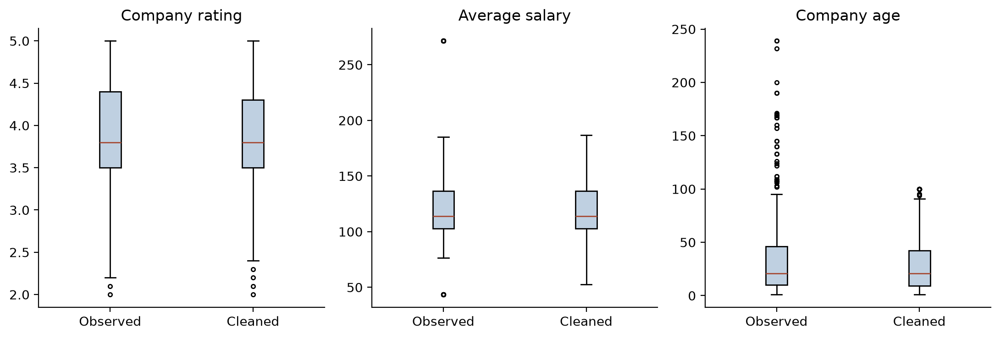
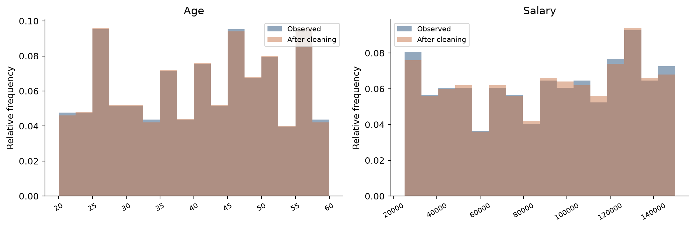

# Data Prep

A data cleaning pipeline for two messy datasets: an employee table with broken numbers and inconsistent text, and 660 data science job postings full of hidden missing values, duplicates and outliers.

One script reads both raw files, repairs what can be repaired, fills the gaps with methods picked from each column's distribution, caps outliers, and writes clean Excel files plus the charts that prove the cleaning didn't distort the data. It runs in a few seconds.



## Results

| | Employees | Job postings |
|---|---|---|
| Rows in → out | 500 → 500 | 660 → 648 (12 exact duplicates dropped) |
| Missing values found | 500 | 1,284, none of them actually empty |
| Missing values left | 0 | 0 |
| Std change from imputation | Age −0.4%, Salary −1.1% | Rating −3.0% |
| Outliers capped | 0 | 41 salaries, 52 company ages |

Imputation never touches a known value: every age, salary and company age that existed before imputation is exactly the same afterwards. The script checks that, along with row counts, value ranges and salary consistency, and stops if any check fails.

## What was wrong with the data

### Employees (`data/employees.xlsx`)

- **Broken scale.** Ages ran from 200 to 600 and salaries were 100 times too big. Somewhere along the way the decimal points were lost: 47.0 became 470, and 123,609.72 became 12,360,972. The file has a second sheet with the same 500 rows stored as CSV text, decimals intact.
- **Inconsistent text.** 50 city names in lower case (`lahore` next to `Lahore`), 59 department names padded with spaces (`" Sales "`), and 20 emails at `gamil.com`.
- **Shared emails.** After the typo fix, 185 rows share an email with a different person. They aren't duplicates, so they're kept and flagged.
- **Half the numbers missing.** 248 ages and 252 salaries.

### Job postings (`data/job_postings.csv`)

- **Hidden missing values.** Not a single cell is empty, but 1,284 are missing anyway. They're written as `-1`, `Unknown`, `Unknown / Non-Applicable` or `na`, and a company rating of `0` means "no rating." `seniority` alone is 86% missing.
- **12 exact duplicate postings.**
- **Wrong types and scales.** `Rating` is stored as an integer times 10 (`38` instead of `3.8`), and the salary range is text (`"137-171 "`) with a trailing space in 641 rows.
- **Wrong derived columns.** 245 `avg_salary` values don't equal (min + max) / 2, and `same_state` was computed by comparing cities instead of states, which got 119 rows wrong.
- **Formatting.** 649 state codes with a leading space, two headquarters listed as `New York, 061`, titles mixing `Sr.`, `Senior` and all caps, and places like `OSAKA, Japan` or `Mc Lean, VA`.

## How it works

```
 data/employees.xlsx ───┐                                          ┌──▶ output/employees_clean.xlsx
                        ├─▶ explore ─▶ repair ─▶ impute ─▶ outliers ─▶ check ─┼──▶ output/job_postings_clean.xlsx
 data/job_postings.csv ─┘                                          └──▶ output/charts/*.png
```

### 1. Explore

For every column, the script counts unique values, values that only differ by case or whitespace, empty cells, hidden missing values, and stray spaces. It prints that table first, and the missing values are drawn as the heatmap above.

### 2. Repair

Fixes that don't involve any guessing come first.

- **The employee scale fix is checked, not assumed.** For every row, taking the value from the second sheet and deleting its decimal point has to give exactly the number on the first sheet. All 500 rows pass, so the correct values are copied over. If a single row didn't match, the script would stop rather than divide by 10 and hope.
- `Rating` is divided by 10 only because every non-zero rating falls between 10 and 50.
- `avg_salary` is recomputed from min and max, and the salary text is checked against both.
- `same_state` is recomputed by comparing the posting's state with the headquarters' state.
- Text is trimmed, case is standardized, and `gamil.com` becomes `gmail.com`.

### 3. Impute

Each column got the method that fits its distribution:

| Column | Missing | Method | Why |
|---|---|---|---|
| Employee age | 248 (50%) | Balanced hot-deck | A median fill would cut the std by 29% |
| Employee salary | 252 (50%) | Balanced hot-deck within department | Same, and salary depends on department |
| Rating | 39 | Median (3.8) | Few missing, roughly symmetric |
| Company age | 107 | Median of the company-size group | Right-skewed (skew 2.17), and older companies tend to be bigger |
| Industry, Sector, Revenue... | varies | Same company's other postings, then `"Not specified"` | Never filled with the most common value |

**Balanced hot-deck:** when half of a column is missing, filling it all with the median piles 250 rows onto one value. Instead, the script takes as many evenly spaced quantiles of the observed values as there are gaps, and shuffles them in with a fixed seed. Every imputed value is one that really occurred, the shape of the distribution survives, and the result is identical on every run.

**Categories:** filling 59 missing industries with "Information Technology" would invent information. They get `"Not specified"` instead, unless the same company has a single consistent value in another posting.

### 4. Outliers

The IQR fences are computed on the data before imputation, so the imputed values can't move them:

| Column | Lower fence | Upper fence | Outliers |
|---|---|---|---|
| avg_salary ($K) | 52.75 | 186.75 | 41 |
| company_age (years) | −44 | 100 | 52 |
| Rating | 2.15 | 5.75 | 2 |

The outliers are capped at the fences, but in **separate** columns (`avg_salary_iqr`, `company_age_iqr`). A $271K data science salary or a 239-year-old company is unusual, not wrong, so the original values stay. The two low ratings (2.0 and 2.1) are real ratings and are left alone.



### 5. Check

The last step compares every numeric column before and after cleaning:

| Column | Mean before | Mean after | Std before | Std after |
|---|---|---|---|---|
| Employee age | 40.42 | 40.42 | 11.37 | 11.33 |
| Employee salary | 90,342.59 | 90,438.49 | 37,810.54 | 37,382.54 |
| Rating | 3.880 | 3.875 | 0.609 | 0.591 |
| avg_salary_iqr | 123.87 | 121.41 | 40.09 | 31.28 |
| company_age_iqr | 36.48 | 30.83 | 40.95 | 28.79 |

Imputation barely moves anything. The capped columns lose a chunk of their std, which is the whole point of capping.



### Output

Each cleaned Excel file has two sheets:

- **CleanData:** the cleaned table.
- **Audit:** one row per record with its source row number and a 0/1 flag for every intervention (imputed age, imputed salary, IQR outlier, shared email, and so on), so any value can be traced back.

## Try it

You need Python 3.12 (anything from 3.10 on should work).

```
git clone https://github.com/tseliasas/data-prep.git
cd data-prep
python -m venv venv
venv\Scripts\activate            # Windows
source venv/bin/activate         # Mac / Linux
pip install -r requirements.txt
python data_prep.py
```

It prints the exploration table, the imputation comparison and the before/after statistics, then writes everything to `output/`:

```
output/
├── employees_clean.xlsx
├── job_postings_clean.xlsx
└── charts/
    ├── 01_employees_missing_heatmap.png
    ├── 01_job_postings_missing_heatmap.png
    ├── 02_missing_rates.png
    ├── 03_employees_boxplot.png
    ├── 04_job_postings_boxplot.png
    ├── 05_employees_histogram.png
    └── 05_job_postings_histogram.png
```

If a library is missing, it tells you the exact `pip install` command instead of throwing a traceback.

## Project structure

```
data-prep/
├── data_prep.py          the whole pipeline: explore, repair, impute, outliers, check, export
├── data/
│   ├── employees.xlsx    raw employee data (two sheets)
│   └── job_postings.csv  raw job postings (semicolon-separated)
├── docs/                 charts used in this README
└── requirements.txt
```

## Limitations

- **Imputed values are plausible, not true.** Hot-deck keeps each column's distribution, but it assumes the missing values look like the observed ones, and it doesn't keep relationships between columns (an imputed age and an imputed salary are drawn independently).
- **The employee fix depends on the second sheet.** Without it, the script refuses to run instead of guessing the scale.
- **The rating scale is inferred.** Dividing by 10 rests on every non-zero rating falling between 10 and 50.
- **Shared emails stay unresolved.** 185 rows share an address with someone else. There's no way to tell which one is right, so they're flagged and kept.
- **`same_state` changed meaning.** It's now a label (`Same state`, `Different state`, `Not specified`) instead of 0/1, because a 0 couldn't tell "different" apart from "unknown."

## Tech stack

Python, pandas, NumPy, Matplotlib, openpyxl
